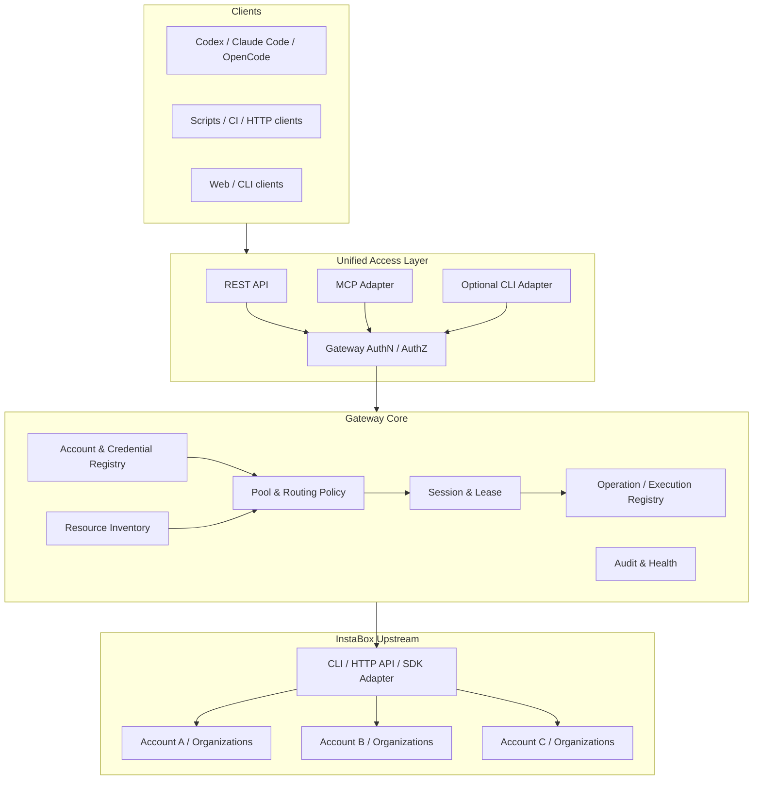
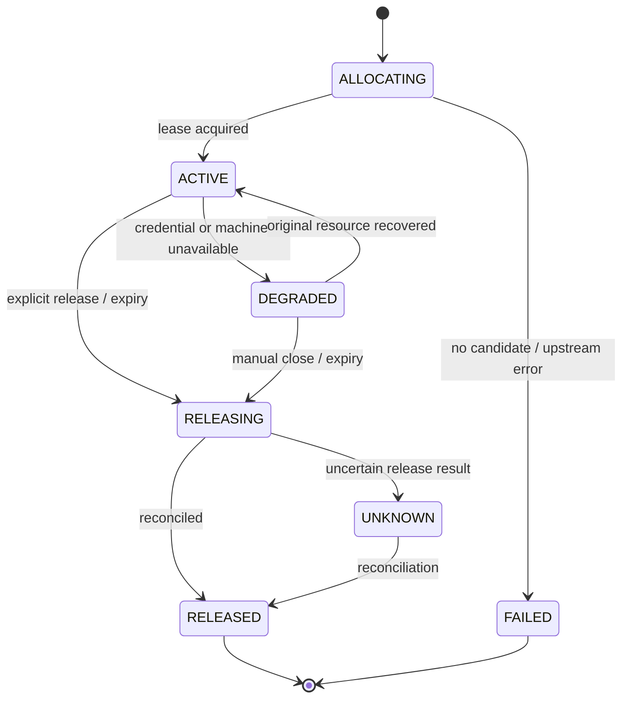

# InstaBox Gateway — 系统设计文档

> **状态**：Draft / 待评审  
> **版本**：v0.1.0  
> **日期**：2026-10-26  
> **目标仓库（暂定）**：[AllenXiao95/InstaBox-Gateway](https://github.com/AllenXiao95/InstaBox-Gateway)  
> **建议仓库路径**：`docs/DESIGN.md`  
> **范围**：InstaBox 多账号聚合、资源池与路由、统一 Endpoint、跨客户端接入  
> **设计性质**：协议与行为设计；**不预先限定语言、框架、数据库、部署形态**。

## 0. 文档摘要

**InstaBox Gateway** 是一个面向 InstaBox 的多账号资源聚合与统一访问应用。它借鉴 [InstaBoxPanel](https://github.com/meicuode/InstaBoxPanel) 的账号/机器管理，以及 [Magpie](https://github.com/yetone/magpie) 的聚合入口、账号组、路由策略和客户端无感切换思想，将多个 InstaBox 账号、组织/工作区及其可见机器纳入同一个可治理的资源视图，并通过稳定的 API、MCP 和可选 CLI 适配向各种客户端提供访问能力。

**产品不是模型 API 网关，也不是 AI 开发框架。** Codex、Claude Code、OpenCode、脚本和普通 HTTP 客户端都是消费者；Gateway 不代理模型推理、不转换模型消息协议，也不要求客户端必须是 Agent。

设计的首要约束是：**模型请求可以按请求级无状态切换，而远程机器具有文件、进程、网络连接等状态；因此 InstaBox 资源路由以「首次分配 + 会话粘性 + 显式释放」为核心，而非无条件按请求轮换。**

---

## 1. 背景与参考项目

### 1.1 InstaBoxPanel：参考已有的管理能力

经检查，InstaBoxPanel 采用多账号验证、身份去重、账号 Key 加密保存、完整分页聚合机器、机器状态/生命周期操作、Web 终端和操作审计等方式管理多个 InstaBox 账号。其实际调用上游 HTTP API，例如 `/v1/me`、`/v1/machines`，并不要求服务端执行原生 InstaBox CLI。

**借鉴**：账号添加/停用/替换凭据、账号身份去重、机器统一视图、生命周期控制、操作记录、密钥不下发浏览器。

**需要重新设计**：面向第三方程序的长期有效客户端身份、跨账号资源分配、同机器多账号可见时的权限选择、会话归属、任务/操作状态、统一 Endpoint 和客户端适配。

> 注意：在评审时仓库未显示明确的许可证（GitHub `license: null`）。本项目借鉴设计思想，不默认复制其受保护源代码。若后续决定直接复用文件，应先确认许可和授权。

### 1.2 Magpie：参考聚合与调度原理，不复用模型功能

**借鉴**：单一入口、账号池/逻辑分组、规则路由、优先级与故障回退、客户端配置统一管理、路由决定的可观察性。

**不借鉴**：模型格式转换、模型提供商映射、Token/上下文计费、推理流式协议。

**必须调整**：Magpie 的请求轮转策略不能原样用于有状态机器。机器选定后，由 Session 维持账号、组织和机器绑定；只有新的独立任务才进入候选机器路由。

### 1.3 InstaBox CLI/API/SDK：能力的事实来源

InstaBox CLI 是面向用户的能力参考和可选执行适配；官方 HTTP API 和 SDK 可以承载服务端调用。**不要求 Gateway 每次都 shell out 到 CLI**。多账号必须使用请求级凭据上下文，不允许并发请求通过共享全局 `login/logout` 状态切换。

官方文档明确支持 `INSTABOX_API_KEY` 环境变量进行 CLI 身份选择；SDK 支持调用级 `apiKey`。命令执行支持 HTTP `/v1/machines/{id}/exec`，CLI 支持 `exec --background` 与 `jobs` 系列辅助操作；两者的任务持久化语义需要分别验证，不应混为一谈。

### 1.4 目标用户

- 管理多个本人或获授权的 InstaBox 账号的人。
- 需要稳定远程执行环境的脚本、CI、CLI、桌面工具与 Agent。
- 希望在一个管理界面查看账号、机器、配额和访问记录的维护者。
- 需要将账户切换和上游密钥从下游客户端配置中抽离的团队或个人。

---

## 2. 目标、非目标与原则

### 2.1 产品目标（Goals）

**G1 多账号**：同时接入、验证、启停和管理多个 InstaBox 账号及其 API Key；支持相同身份的凭据更换与去重。

**G2 统一资源视图**：整合不同账号/组织中的机器、状态、规格、配额、快照与可用能力，避免同一实际机器被重复展示为独立算力。

**G3 统一访问**：为程序调用提供稳定、版本化的资源操作接口；对不同客户端按协议适配，而不重写路由核心。

**G4 无感路由与可控切换**：支持指定账号、指定机器和自动路由；自动路由只对新 Session 生效；支持优先级、故障回退及负载相关策略。

**G5 多客户端、多平台**：API/MCP/可选 CLI 接入；运行平台目标包括 Windows、macOS、Linux；管理界面可通过浏览器使用。平台兼容不意味着所有平台必须采用同一封装形式。

**G6 安全与可解释性**：原始密钥不泄露给客户端；每次路由有确定结果与解释；高风险操作受权限和确认控制；错误可追溯。

### 2.2 非目标（Non-goals）

- 不提供 OpenAI-compatible、Anthropic Messages、Responses 等**模型 Endpoint**。
- 不代理 LLM 推理，不处理 Token 计费、模型上下文或模型选择。
- 不自行创造新的云计算 Provider；第一期只面向 InstaBox。
- 不强制采用某种开发框架、数据库、微服务或容器编排方案。
- 不承诺无缝迁移已有机器的进程/磁盘/网络会话。
- 不通过多账号自动化规避上游服务条款、权限或配额限制。
- 不在 MVP 中建设完整的通用任务平台、工作流编排或 AI 自动开发系统。

### 2.3 设计原则

1. **One Gateway, Many Accounts**：下游只需一个入口与自己的 Gateway 凭据。
2. **Identity ≠ Credential ≠ Machine**：用户身份、访问凭据、组织权限、机器和会话是不同实体。
3. **Explicit State**：自动路由用于新会话；已有会话保持机器绑定。
4. **No Silent Side Effects**：查询不得默认唤醒机器；创建、删除、发布端口等需要明确意图。
5. **Least Privilege**：按客户端、资源池、机器和操作授权，写权限与删除权限分离。
6. **Observable Decisions**：记录候选集、排除原因和最终路由对象，但绝不记录密钥明文。
7. **Adapter Not Framework**：CLI/HTTP/SDK/客户端协议只是适配；核心域模型和契约独立于其实现。

---

## 3. 逻辑架构



### 3.1 边界职责

| 模块 | 责任 | 不负责 |
| --- | --- | --- |
| Account Registry | 账号身份、凭据、状态、权限和组织关联 | 给客户端直接返回上游 Key |
| Inventory | 机器/组织/配额/能力的当前与最近快照 | 把过期缓存误称为实时信息 |
| Router | 基于候选资源与策略决定新 Session 的归属 | 在已有 Session 中偷偷重选机器 |
| Session / Lease | 绑定、占用、续约、释放、过期处理 | 宣称是上游物理独占锁 |
| Operation Registry | 生命周期操作、执行状态、结果与未知态对账 | 代替上游实际执行成功的证明 |
| Capability Adapter | 统一 CLI/API/SDK 差异与错误 | 擅自扩大上游权限 |
| Endpoint Adapters | 对外 REST、MCP、CLI 等协议呈现 | 内建各客户端业务逻辑 |
| Management UI | 管理账号、池、策略、连接与审计 | 保存原始长期密钥在浏览器 |

### 3.2 部署边界（开放）

以下均为允许的部署形态，而非第一版选型结论：

- 个人本机常驻服务 + 本机 Endpoint。
- 局域网/自托管网关 + 独立客户端认证。
- 桌面应用包裹本地服务。
- 可访问上游 API 的远程服务。

所有形态共享同一资源模型、状态与安全契约。**是否长期托管后台 Job** 会影响进程/存储需求，应在实现验证后决定具体技术。

---

## 4. 领域模型与标识

### 4.1 核心实体

| 实体 | 重要字段（概念层） | 说明 |
| --- | --- | --- |
| Account | `account_id`, `upstream_user_id`, `alias`, `enabled`, `health` | 根据 `/v1/me` 校验同一上游用户身份；可为一账号保存多凭据 |
| Credential | `credential_id`, `account_id`, `secret_ref`, `scopes`, `expiry`, `status` | 服务端托管，Key 可轮换；不明文出现在日志/UI/API |
| Organization / Workspace | `org_id`, `account_id`, `roles`, `limits` | 上游组织/工作区可独立于用户身份；组织关系以官方接口事实为准 |
| Machine | `resource_id`, `upstream_machine_id`, `upstream_org_id`, `name`, `state`, `capabilities` | 统一展示的实际资源 |
| MachineVisibility | `resource_id`, `account_id`, `credential_id`, `permissions` | 一个资源可被多个账号或凭据访问 |
| Pool | `pool_id`, `selectors`, `policy`, `enabled` | 面向新 Session 的逻辑资源集合 |
| Client | `client_id`, `auth_ref`, `allowed_pools`, `permissions` | 下游访问主体；不是上游 InstaBox 账号 |
| Session | `session_id`, `client_id`, `resource_id`, `account_id`, `credential_id`, `state`, `expires_at` | 对某台机器与访问身份的稳定绑定 |
| Lease | `lease_id`, `session_id`, `resource_id`, `mode`, `expires_at`, `version` | Gateway 级逻辑租约，用于约束竞争访问 |
| Operation | `operation_id`, `upstream_operation_id`, `idempotency_key`, `state`, `target`, `kind` | 生命周期等变更操作，可能异步完成 |
| Execution | `execution_id`, `session_id`, `command`, `status`, `exit_code`, `logs_ref` | 命令执行可独立追踪；可由同步执行或后台执行形成 |

### 4.2 资源唯一性与去重

- **内部稳定主键**采用 Gateway 自己的 `resource_id`，不使用机器显示名作为 ID。
- 上游定位元组推荐为 `(provider='instabox', org_id, upstream_machine_id)`；实际是否能对同机器多账号进行全局去重，应以返回的机器 ID/组织 ID 及可证明的身份关系为准。
- 如果不同账号返回相同机器 ID 且能够验证为同一实体：展示一个资源，保留多条 `MachineVisibility`。
- 如果机器标识不足以证明相同：**不做激进去重**，先保留两个条目并标记待确认。
- 不假设机器名称在账号/组织间全局唯一。
- 账号 Key 失效、删除后不应抹掉历史审计中的归属与上游标识。

### 4.3 配额维度

至少区分：账号/组织机器数量上限、运行中机器数量、快照/存储、操作并发和权限范围。配额应优先读取上游可用的实际值，不写死免费/付费套餐常量；无法获得的维度标为 `unknown`，不能解释为无限额或零。

---

## 5. CLI / HTTP API / SDK 能力映射

下表用于建立**首版能力清单**，不是承诺全部进入 MVP。官方 CLI 是用户可见的操作参考；网关可通过 HTTP API 或 SDK 完成等效能力。

| 能力域 | CLI 代表命令 | 上游 API/SDK 依据 | 网关规划 | 阶段 |
| --- | --- | --- | --- | --- |
| 账号验证 | `whoami`, `usage`, `keys` | `/v1/me`, `/v1/usage` 等 | 账号验证、配额、Key 轮换 | P0 |
| 机器读取 | `ls`, `get`, `templates` | Machine list/info/templates | 跨账号聚合与按权限筛选 | P0 |
| 机器生命周期 | `create`, `start`, `stop`, `suspend`, `resume`, `rm` | Machines / Lifecycle API | 统一操作与幂等/确认 | P1/P2 |
| 机器属性 | `rename`, `auto-suspend`, workspace/metadata 命令 | Machine patch / info | 仅在权限允许时更新 | P2 |
| 命令执行 | `exec` | `POST /v1/machines/{id}/exec` / SDK `commands` | 同步执行与真实 exit code | P1 |
| 后台任务 | `exec --background`, `jobs ls/logs/wait/kill`, `ps` | CLI 通过 exec 构建部分能力；SDK 可 `background: true` | Gateway Execution Registry + 状态对账 | P2 |
| 终端连接 | `ssh` | SSH credentials / terminal API | 会话授权、短期连接凭据 | P2 |
| 文件访问 | `files`, `cp` | Files API / SDK files | 目录浏览、上传下载 | P1/P2 |
| 快照 | `snapshot`, `fork` | Snapshots API / SDK | 保存/恢复/派生资源 | P2 |
| 网络 | `port publish`, `port-forward` | Ports API / tunnels | 公共发布需要单独授权；私有转发优先 | P2 |
| 桌面浏览器 | CLI/SDK 对应工具（需核对版本） | SDK desktop/API | 截图、操作、临时分享 | P3 |
| Vault / Secrets | `vault`, `secrets` | 上游秘密管理 API | 强权限、独立审计 | P3 |

**必须验证的差异**：CLI 是否在不同系统上需要 SSH/本地配置；`jobs` 是 CLI 在远端构造的后台任务层而非等价于可持久查询的上游 Job API；CLI 的非 JSON 交互输出不能作为服务端稳定协议；上传大小、实时输出、WebSocket/连接生命周期及各操作实际所需 scopes 应以选定版本文档与集成测试为准。

### 5.1 适配器调用约束

1. 每次上游请求显式携带选定 `credential_id` 所对应的授权上下文。
2. CLI fallback 使用**独立进程环境**传递 `INSTABOX_API_KEY`；不修改共享全局登录文件。
3. 不允许客户端上传任意上游 Base URL 使服务端成为 SSRF 代理；上游地址由管理员配置、校验和允许列表限定。
4. 尽量使用结构化 API/SDK 响应；CLI 只处理经验证的能力与参数。
5. 命令使用明确的 `argv` 或命令文本字段，避免把用户参数无约束拼接进 shell。
6. 上游 API 版本变化按能力探测和契约测试处理，不能把缺失能力误报为成功。

---

## 6. 资源池与路由策略

### 6.1 路由模式

| 模式 | 行为 | 适用范围 |
| --- | --- | --- |
| `explicit` | 显式 `resource_id` 或 `account_id`，不做跨账号回退 | 手动指定、固定工作区 |
| `priority` | 根据池内账号/机器优先级选择；只有分配前失败才回退 | 默认策略候选 |
| `least_busy` | 在可信负载/租约指标内选资源；指标缺失时明确退化行为 | 多任务分配 |
| `round_robin` | 按新 Session 轮询，而非每次命令轮询 | 独立短任务 |
| `sticky` | 已有 `session_id` 必须指向原资源和访问账号 | **所有有状态会话默认约束** |

> `sticky` 严格说是一条会话不变量，而非与 `priority` 等互斥的资源挑选策略。池的选择策略可为 `priority`，但分配后仍实行 sticky。

### 6.2 新 Session 候选条件

优先只保留同时满足以下条件的资源：

1. 客户端对池/资源具有授权；
2. 账号与凭据启用、未确认失效，scope 满足目标操作；
3. 组织/机器可见，能力匹配（如需要 desktop）；
4. 资源处于可使用状态，且调用策略明确允许唤醒已暂停机器；
5. 上游配额足够，且 Gateway 中无与该任务冲突的租约；
6. 资源未在本地熔断或维护状态。

排序优先由池策略决定；如选定资源在**尚未创建任何副作用前**失败，可以重新选择候选资源。`execution_started` 或 Session 绑定后禁止静默切换。

### 6.3 账号切换语义

- **管理端手动切换当前账号**：仅改变管理界面后续操作的默认筛选，不改写已有会话。
- **客户端改变 Pool / routing policy**：仅影响之后创建的 Session。
- **凭据轮换**：相同上游身份、足够权限时可更新凭据引用；对已有 Session 的权限变化必须重新校验，不保证无中断。
- **正在执行的账号被禁用**：禁止新的会话与敏感写操作；已有执行进入受控收尾/错误状态，不冒充迁移成功。

### 6.4 同一机器多账号可见

同一资源如由多个账号可见，路由结果必须同时选定 `(resource_id, account_id, credential_id)`。只返回机器 ID 会导致权限漂移：一个具有读权限的凭据不一定能替代具有写权限的凭据。绑定之后不应任意替换访问身份。

---

## 7. Session、Lease 与操作状态

### 7.1 Session 状态机



- Lease 是 Gateway 侧的**逻辑互斥/预订**，不等于 InstaBox 的物理独占锁，也不能阻止用户绕过 Gateway 直接登录机器。
- P0/P1 默认保守：每台机器仅允许一个**独占写会话**，只读监控可并行；后续可引入共享模式但必须先验证冲突控制。
- Session 包含 `expires_at`、心跳/续租和 `lease_version`，由原子化分配防止两个并发客户端获取同一写租约。
- Session 释放**不等于**暂停、停止或删除机器。资源生命周期应独立授权、独立操作。
- 服务重启后通过持久 Session/Lease 与上游查询恢复或标记 `UNKNOWN`，不静默覆盖。

### 7.2 Operation / Execution 状态

建议统一操作状态：`PENDING -> RUNNING -> SUCCEEDED | FAILED | CANCELED | UNKNOWN`；对命令执行保存 `exit_code`、`stdout_ref`、`stderr_ref`、`timed_out`、`truncated`、`started_at`、`ended_at`。上游 HTTP 返回成功但命令退出码非零，必须记为**执行失败**（或 `COMPLETED_NONZERO`，但不可显示为测试通过）。

`UNKNOWN` 用于请求可能到达上游但无法确认结果的情形，不能无条件重放。生命周期调用应使用上游要求的幂等键，并查询 operation 状态；对非幂等命令，自动重试只能在有执行去重机制且可确认前次未运行时启用。

### 7.3 背景执行的现实边界

上游单次 exec 有运行时长与输出大小限制。CLI 的 `jobs` 和 SDK 的 background handle 可支持特定后台操作，但 Gateway 若承诺跨进程重启查询/取消任务，必须自行定义：

- `execution_id` 与上游 machine/process/job 的持久映射；
- 日志落盘或可恢复引用；
- 任务结束、机器暂停/停止、网关重启后的对账策略；
- 取消请求可能无法立即生效，返回状态必须准确；
- 不要求同步 HTTP 一直保持连接直到长任务结束。

MVP 可以先支持同步短命令与明确 `UNKNOWN` 状态，稳定后扩展持久后台执行。

---

## 8. 统一 Endpoint：协议与行为契约（草案）

### 8.1 命名空间

- `https://<gateway-host>/api/v1`：平台无关的 REST 管理/执行接口。
- `https://<gateway-host>/mcp`：Agent MCP 适配接口（Streamable HTTP 或客户端支持的模式）。
- 可选 `igw` CLI：REST 的本地用户界面/脚本接口，不要求实现完全兼容官方 `instabox` 的命令或认证存储。

**统一 Endpoint 指统一访问入口与一套行为契约，不意味着所有客户端必须使用同一种协议。**

### 8.2 核心接口

| 方法 | 路径 | 主要语义 | 首期 |
| --- | --- | --- | --- |
| GET | `/accounts` | 查看可见账号（脱敏） | P0 |
| POST | `/accounts` | 管理员新增账号与凭据 | P0 |
| PATCH | `/accounts/{account_id}` | 启停、改名、凭据轮换 | P0 |
| GET | `/machines` | 合并后的资源视图，可按账号/池过滤 | P0 |
| GET | `/machines/{resource_id}` | 资源详情与访问身份列表（按权限） | P0 |
| GET | `/pools` | 资源池配置/当前健康状态 | P1 |
| POST | `/sessions` | 新分配/绑定指定机器或自动路由 | P1 |
| GET | `/sessions/{session_id}` | 会话归属、状态、租约到期时间 | P1 |
| POST | `/sessions/{session_id}/renew` | 续租（受权限限制） | P1 |
| DELETE | `/sessions/{session_id}` | 释放会话与租约（非销毁机器） | P1 |
| POST | `/sessions/{session_id}/exec` | 在绑定机器执行命令 | P1 |
| GET | `/executions/{execution_id}` | 状态、退出码、日志位置 | P1 |
| POST | `/executions/{execution_id}/cancel` | 尝试取消执行；允许不支持的明确响应 | P2 |
| GET/POST | `/sessions/{session_id}/files` | 文件浏览/上传等 | P2 |
| POST | `/machines/{resource_id}/actions` | 受权的生命周期操作 | P2 |
| GET | `/operations/{operation_id}` | 查询机器变更操作状态 | P2 |

**不直接暴露任意路径的上游原样代理**。机器、文件、终端、端口等动作必须有明确授权与路径/参数约束。Web UI 可以使用独立管理 API，但不应绕过相同的权限核心。

### 8.3 典型请求

**创建会话（自动路由）**

```http
POST /api/v1/sessions
Authorization: Bearer <gateway-client-token>
Idempotency-Key: example-request-001
Content-Type: application/json

{
  "pool_id": "development",
  "selector": { "capabilities": ["exec", "files"] },
  "routing": { "mode": "auto", "allow_wake": false },
  "lease": { "mode": "exclusive", "ttl_seconds": 1800 }
}
```

**响应示例（草案，不是 InstaBox 原生响应）**

```json
{
  "session_id": "ses_01JEXAMPLE",
  "resource_id": "res_01JEXAMPLE",
  "pool_id": "development",
  "state": "ACTIVE",
  "expires_at": "2026-10-26T11:30:00Z",
  "routing": {
    "strategy": "priority",
    "selected_account_alias": "primary",
    "reason_code": "highest_priority_eligible"
  }
}
```

响应不返回上游 API Key。是否向有权限的客户端暴露上游 machine ID，应作为独立权限控制，默认返回 Gateway 内部资源 ID。

**执行命令**

```http
POST /api/v1/sessions/ses_01JEXAMPLE/exec
Authorization: Bearer <gateway-client-token>
Content-Type: application/json

{
  "argv": ["python3", "--version"],
  "cwd": "/data/home",
  "timeout_seconds": 30
}
```

优先允许明确 argv 形式以减少 shell 拼接风险；如支持 `cmd`，需要清楚标识是 shell 模式。客户端不能自行更换此 Session 的账号/机器；命令执行的环境变量应经过敏感值遮蔽与审计策略。

**执行结果示例**

```json
{
  "execution_id": "exe_01JEXAMPLE",
  "session_id": "ses_01JEXAMPLE",
  "state": "SUCCEEDED",
  "exit_code": 0,
  "stdout": "Python 3.x.x\n",
  "stderr": "",
  "timed_out": false,
  "truncated": false
}
```

### 8.4 响应、错误和版本化

- API 响应中返回 `request_id` / 可追踪的 `operation_id`，便于审计。
- 错误结构统一为 `error.code`、`message`、`retryable` 和 `details`（脱敏），不把上游原始错误透传给非管理员。
- 常见错误：`ACCOUNT_UNAVAILABLE`, `INSUFFICIENT_SCOPE`, `NO_ELIGIBLE_RESOURCE`, `RESOURCE_BUSY`, `SESSION_EXPIRED`, `SESSION_DEGRADED`, `UPSTREAM_RATE_LIMITED`, `UPSTREAM_UNKNOWN_RESULT`, `OPERATION_REQUIRES_CONFIRMATION`。
- 建议以 HTTP 401/403/404/409/422/429/502/503 反映鉴权、冲突、参数、配额和上游异常；`UNKNOWN` 不得伪装为成功。
- `/api/v1` 稳定化之后保持向后兼容；上游 CLI/API 升级由适配器消化，破坏性变更才引入 `/api/v2`。
- 列表接口统一支持游标/分页；大文件和大日志返回下载句柄，不能无限内嵌响应。

### 8.5 MCP 能力分级

**基础只读**：`list_accounts`, `list_resources`, `get_resource`, `list_pools`, `get_session`。

**受控执行**：`acquire_session`, `execute`, `get_execution`, `release_session`。

**高风险可选**：`create_machine`, `delete_machine`, `publish_port`, `manage_secrets`, `restore_snapshot`；默认不暴露到普通 Agent 客户端，需要能力标记与授权。

MCP 仅是上述行为契约的适配层：参数、状态、审计、会话归属均复用同一 Core，不出现只有 MCP 才允许的隐藏后门。

### 8.6 CLI 兼容层范围

建议先设计 `igw accounts`, `igw machines`, `igw session acquire|release`, `igw exec`, `igw pools`, `igw config`。这属于 Gateway 自身 CLI。若后续要实现官方 `instabox` 命令的透明兼容，应单独列出逐命令、参数、TTY/SSH、错误退出码和认证文件兼容矩阵，避免把不完整的兼容性写成已支持。

---

## 9. 安全模型

### 9.1 身份边界

- **Upstream Credential**：InstaBox Key，只能由服务端 Secret Store 解密并用于上游请求。
- **Gateway Client Credential**：下游 CLI、UI、Codex 等使用的独立 Token 或交互认证；不得视为上游 Key。
- **Account / Machine Authorization**：客户端只可访问被授权的池、账号、机器及操作。
- **Admin** 与 **Client** 权限分离；客户端不因拥有 exec 权限而获得账号管理、机器删除、公开端口或上游 Secrets 管理权。

### 9.2 具体控制

1. 上游 Key 加密保存，UI 只显示后缀；支持主动失效、轮换、导出限制与审计。
2. 服务端对上游域名、路径、请求参数进行约束；禁止任意目标 URL 代理。
3. 命令执行默认高风险：权限控制 + 明确机器绑定 + 可选命令策略/审批；**无法保证命令任意执行却仍安全**，不要把这个问题简化成 shell 转义。
4. 文件读写限制授权工作目录；防范 `..` 路径、符号链接跳转及过量上传；上游 root 读取能力不意味着向普通客户端开放全盘。
5. 不允许低权限 Agent 调用删除机器、快照、Key，或修改对外端口；高危操作必须显式确认目标、审计且不可被重复请求绕过。
6. 端口与桌面临时链接被视为敏感访问凭据，限制 TTL、支持撤销，默认不向公网发布。
7. 操作日志不记录 API Key、秘密环境变量、完整敏感命令输出；敏感值以掩码和引用代替。
8. 默认本机 loopback 监听；如果部署公网，必须使用 TLS、强认证、速率限制与来源控制。
9. 定义删除账号的含义为**删除 Gateway 中凭据与关联关系**，不调用 InstaBox 删除机器；历史审计按保留策略处理。

### 9.3 多账号并不意味着越权共享

仅在账号拥有者明确授权时聚合资源。每个账号的配额、权限和组织边界应得到尊重；候选池和调度不能绕过上游平台政策。上游拒绝的权限不得由其他账号身份自动执行同一敏感指令，除非客户端对此目标和替代身份均有授权。

---

## 10. 管理界面与使用体验（信息架构）

| 页面 | 核心内容 |
| --- | --- |
| Overview | 账号健康、机器数量/状态、配额概要、最近故障 |
| Accounts | 添加、验证、启停、替换 Key、权限、账户身份去重 |
| Machines | 聚合机器列表、归属/可见身份、状态、手动生命周期操作 |
| Pools & Routing | 资源池、筛选条件、优先级、策略与路由预览 |
| Clients / Connections | 下游 Token、权限、Endpoint、MCP/CLI 接入示例 |
| Sessions & Executions | 会话占用、租约、命令执行状态、取消与日志 |
| Audit & Settings | 路由决策、操作审计、凭据状态、部署与访问设置 |

UI 应允许选择“按账号看机器”或“按资源看可见账号”，并始终显示是**实时检查结果**还是**最近同步数据**。管理端账户筛选不应影响正在运行的客户端 Session。

---

## 11. 可用性、可观察性与恢复

### 11.1 健康检测

- 账号校验区分 `HEALTHY`、`DEGRADED`、`INVALID_CREDENTIAL`、`INSUFFICIENT_SCOPE`、`RATE_LIMITED`、`UNKNOWN`，避免简单布尔在线状态。
- 健康轮询具有退避和抖动，不频繁唤醒已暂停机器。
- 若后台同步失败，可使用标记为 stale 的缓存显示历史资源，但**不能用缓存确认资源当前可用**。

### 11.2 审计字段

最小记录：`timestamp`, `request_id`, `client_id`, `session_id`, `pool_id`, `account_id`, `resource_id`, `action`, `decision_reason`, `upstream_operation_id`, `result`, `latency`, `error_code`。仅记录必要的可观察字段，敏感命令/文件内容由独立策略决定是否脱敏保存。

### 11.3 重启与对账

- 网关重启后可以加载账户、池、Session 与执行状态。
- 上游状态与本地状态冲突时，先标记不确定，再按实际机器/operation/后台任务对账。
- 没有可靠上游可查询状态的后台进程，不承诺“重启后必然恢复实时输出”。
- 关闭 Gateway 不等于暂停所有 InstaBox VM；这是管理边界而非自动销毁策略。

---

## 12. 需求分级与实施阶段（非技术选型）

| 阶段 | 范围 | 核心可交付结果 |
| --- | --- | --- |
| P0 · Identity & Inventory | 两个以上合法账号接入；身份去重、Key 隔离、机器/配额聚合、只读 API | 跨账号统一机器列表与可解释的归属 |
| P1 · Pool & Endpoint | 资源池、路由、Session Lease、短命令执行、统一 REST/MCP | 客户端配置一次 Endpoint 后可完成分配→执行→查询→释放 |
| P2 · Management & Operations | 生命周期操作、文件、CLI、终端、任务审计和管理 UI；可靠后台作业 | 常用 InstaBox CLI 能力可在受控权限下统一使用 |
| P3 · Advanced Capabilities | 快照、端口、桌面、多平台分发、策略优化 | 高级能力映射与可恢复操作体验 |

**阶段之间有明确验收门槛**。P0 不要求 UI 完整；P1 不要求复杂算法；P2 不应在核心路由正确性尚未验证时过度扩张。

### 12.1 首版验收用例

| ID | 场景 | 验收标准 |
| --- | --- | --- |
| A01 | 接入两个不同用户账号 | 可并行读取，凭据和结果不串号 |
| A02 | 相同上游身份重复接入 | 识别重复用户并允许按明确规则替换/增加凭据 |
| A03 | 同一机器跨账号可见 | 能确认时正确去重，保留权限不同的可见性关系 |
| A04 | 两客户端同时分配同一独占机器 | 最多一个成功获得有效写租约 |
| A05 | 新 Session 自动路由 | 选择满足权限、能力、配额、健康约束的资源并记录理由 |
| A06 | Session 中途禁用原账号 | 不迁移到另一账号机器，不丢失可查询的错误状态 |
| A07 | CLI/API 同时操作不同账号 | 互不影响认证上下文和实际执行对象 |
| A08 | 同步命令返回非零 exit code | 失败状态和退出码准确透传给授权客户端 |
| A09 | 请求发送后网络断开 | 状态为 UNKNOWN 或可查询，不自动盲重试非幂等命令 |
| A10 | 无权限调用机器删除/端口发布 | 明确拒绝、留下审计记录、机器无变化 |
| A11 | 网关进程重启 | 持久化绑定可恢复或标记待对账，不创建重复租约 |
| A12 | Codex / 普通 HTTP 客户端 | 使用相同资源核心完成机器查询与远端执行 |

### 12.2 推荐的验证顺序

1. 先完成官方 CLI/API/SDK 操作矩阵，冻结一个受测版本。
2. 使用至少两个**经授权**账号检查 `me`、`usage`、`machines`、权限差异。
3. 验证同一机器多账号可见、同名不同机器、断网/失效 Key 等边界。
4. 用两个并发客户端验证独占 Lease 与 Session Sticky。
5. 完成 `POST /sessions` 与 `POST /sessions/{id}/exec` 端到端，并记录真实退出码。
6. 再引入 MCP、CLI 适配、UI 与长任务/高级能力。

---

## 13. 关键设计决策与待定问题

### 13.1 已确定（本草案建议）

- 只面向 InstaBox 多账号聚合与统一访问，**不做模型 Endpoint**。
- 参考 InstaBoxPanel 的管理逻辑与 Magpie 的账号/路由思想，但不复制其产品范围。
- CLI 是重要能力基准；HTTP API/SDK 是可用实现通道，二者不互斥。
- 下游单一入口、多协议适配；上游每请求隔离身份。
- 新 Session 可路由；已有 Session 资源固定，不静默迁移。
- 安全边界和权限模型优先于界面与复杂调度算法。
- 暂定开发仓库 `AllenXiao95/InstaBox-Gateway`，文档建议落在 `docs/DESIGN.md`。

### 13.2 待验证（不阻塞概念设计）

- 官方 CLI 的完整命令/参数/返回码版本锁定；`jobs`、TTY、SSH、文件大小的实测边界。
- 账号和工作区权限关系；相同机器跨账号可见时的全局 ID 一致性。
- 上游 API/SDK 的后台 Job 与持续日志可恢复程度。
- 原生 CLI 兼容是否值得做为一类正式目标，还是只提供 Gateway 自身 CLI。
- 公网托管网关时需要怎样的访问控制与密钥托管方案。
- 是否第一期提供组织/团队级多用户管理，还是先只支持单管理员 + 多客户端 Token。
- 默认是否允许唤醒已暂停机器、是否允许已有机器共享只读访问。

### 13.3 暂不做决定（Implementation-neutral）

- 开发语言、前后端框架、数据库、中间件、桌面打包方案。
- 自托管单体还是分布式多实例。
- 是否采用消息队列或单独任务 Worker。
- UI 风格、项目目录结构及 CI 平台。

这些决策应在 P0/P1 的行为契约和并发测试建立之后，用实际需求与约束来选择。

---

## 14. 风险与批判性视角

| 风险 | 影响 | 对策 |
| --- | --- | --- |
| “自动切换账号”被误解为迁移运行中机器 | 状态丢失、错误执行位置 | 严格区分新任务路由与已有会话绑定 |
| 只以机器名去重 | 不同机器被合并 | 以已核实的上游机器/组织标识去重 |
| 网关逻辑租约被当成物理锁 | 外部直接操作导致冲突 | 明确租约保证范围、对关键操作做冲突/状态检查 |
| 高权限 Key 与任意命令执行叠加 | 跨账号高危破坏 | 凭据隔离、能力授权、显式确认、审计 |
| 过度依赖 CLI 纯文本输出 | 版本升级后解析失效 | 优先结构化 API/SDK，CLI 兼容验证与版本固定 |
| 误认为后台 exec 原生可恢复 | 网关重启导致丢失任务关联 | 独立 Execution Registry 与对账机制 |
| 资源池按账号数量估计容量 | 错误调度、上游 429 | 读取真实配额与可用状态；保守处理 unknown |
| 第一版就追求“完整 CLI 兼容” | 复杂度失控 | 优先核心读/执行路径，逐能力域扩展 |
| 参考项目版权不明 | 不可合法直接复用源码 | 只借鉴思想，源码复用需确认许可 |

**最关键的成败标准**不是支持多少 CLI 命令，而是：多个账号是否真正彼此隔离、资源是否能被准确选择、客户端是否无需感知切换、会话与执行结果能否被可靠追踪。

---

## 15. 参考资料与核验说明

查询日期：**2026-10-26**。资料可能更新；开发前应以受测版本和接口集成结果再次确认。本文中的 `/api/v1/*` 是 **Gateway 拟定接口**，不是 InstaBox 官方已有接口。

1. [InstaBox CLI Reference](https://instabox.sh/docs/cli) — CLI 命令和环境变量认证。
2. [InstaBox API Overview](https://instabox.sh/docs/api) — 身份验证、幂等性、错误规范。
3. [InstaBox SDK Reference](https://instabox.sh/docs/sdk) — 请求级 Key、命令、文件、快照、桌面等能力。
4. [InstaBox Commands & Files API](https://instabox.sh/docs/api/commands) — 命令限制、返回结果、文件接口。
5. [InstaBox Account / Limits](https://instabox.sh/docs/api/account) / [Limits](https://instabox.sh/docs/limits) — 配额维度。
6. [InstaBoxPanel](https://github.com/meicuode/InstaBoxPanel) — 多账号与机器管理的参考实现。
7. [Magpie](https://github.com/yetone/magpie) — Gateway、Routing Group、账号池、客户端无感访问的设计参考。
8. [暂定开发仓库：InstaBox-Gateway](https://github.com/AllenXiao95/InstaBox-Gateway) — 2026-10-26 检查时为新建私有仓库，尚无既有实现约束。

---

## 16. 下一步产物

在本设计文档评审通过后，建议按以下顺序继续，而不是立即确定框架：

1. `docs/CAPABILITY_MATRIX.md`：InstaBox CLI/API/SDK 逐命令与权限映射，标注验证证据。
2. `docs/API_CONTRACT.md` 或 OpenAPI：Gateway REST、错误码、资源标识、会话和异步任务协议。
3. `docs/ACCEPTANCE.md`：两账号、两客户端、冲突分配、断线恢复及越权防护的可执行验收集。
4. P0 最小原型：真实连接多个授权账号，证明身份隔离、资源聚合、无状态并发调用是正确的。

**本文件为设计草案，并不声明上游官方全部命令已进行真人账号集成测试。**